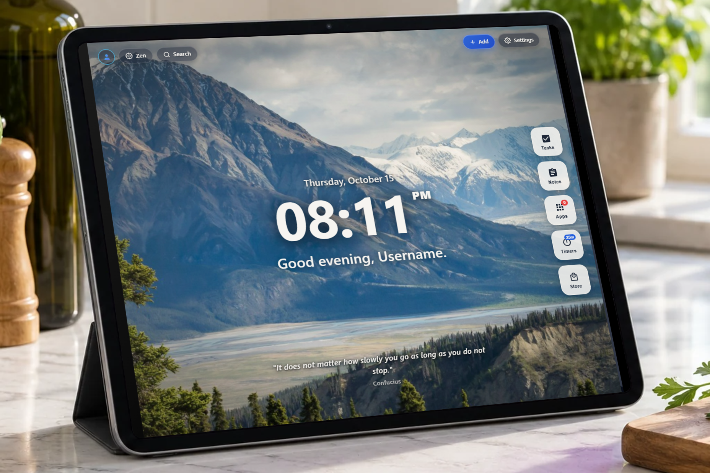
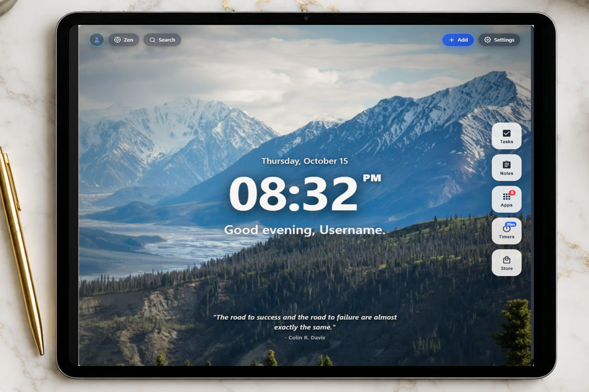
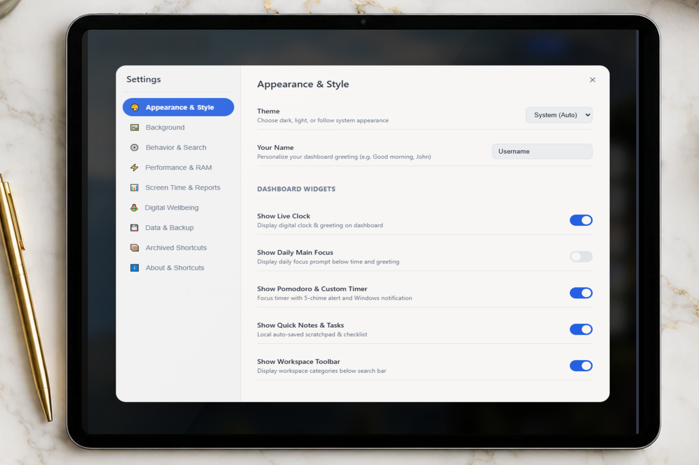
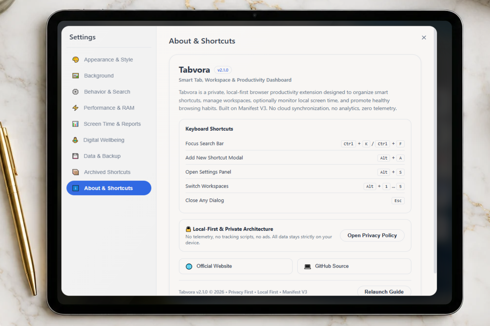
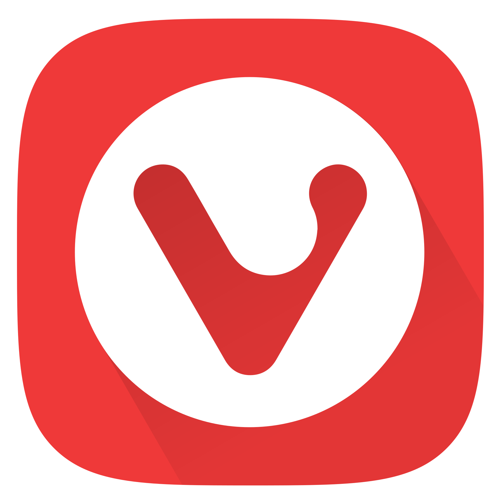

<div align="center">

# Tabvora – Smart Tab & Browser Productivity Dashboard

**A Privacy-First Chrome New Tab Extension for Workspaces, Bookmarks, Tab Management & Productivity**

Turn your browser's new tab into a clean, customizable workspace. Tabvora brings smart shortcuts, project workspaces, RAM Saver, a Pomodoro focus timer, quick notes, wallpapers, and digital wellbeing tools together in one local-first browser extension.

[](https://chromewebstore.google.com/detail/ibejmhkigcbnfnobfkeebfnpodlpgjab)
[](https://developer.chrome.com/docs/extensions/develop/migrate/what-is-mv3)
[](#supported-browsers)
[](#privacy--local-first-architecture)
[](LICENSE)

<br/>

<a href="https://shajibsikder.github.io/tabvora/">
  
</a>

<br/>

[Website](https://shajibsikder.github.io/tabvora/) ·
[Chrome Web Store](https://chromewebstore.google.com/detail/ibejmhkigcbnfnobfkeebfnpodlpgjab) ·
[Privacy Policy](https://shajibsikder.github.io/tabvora/privacy.html) ·
[Security](https://shajibsikder.github.io/tabvora/security.html) ·
[Report an Issue](https://github.com/shajibsikder/tabvora/issues)

</div>

---

## Overview

**Tabvora is a Chrome new tab extension and browser productivity dashboard** designed to make everyday browsing more organized, focused, and personal. It replaces the default new-tab page with a customizable workspace where you can organize website shortcuts, separate projects into workspaces, manage inactive tabs, take quick notes, and build healthier browsing habits.

Instead of relying on an account-based cloud service, Tabvora is designed around local-first storage. Your shortcuts, notes, workspaces, and preferences are kept in browser storage on your device. The extension is built for people who want a useful new tab page without unnecessary clutter or background tracking.

### Why Tabvora?

- **Organize your browser:** Keep frequently used websites, bookmarks, and project links in one dashboard.
- **Separate projects:** Create dedicated workspaces for development, research, study, work, and personal browsing.
- **Manage inactive tabs:** Use RAM Saver to discard eligible background tabs when you choose.
- **Stay focused:** Use the built-in Pomodoro timer, reminders, and website time limits.
- **Capture ideas quickly:** Write and export notes directly from your new tab.
- **Make it yours:** Personalize the dashboard with wallpapers, themes, widgets, and minimalist mode.
- **Keep data local:** Tabvora does not require an account or cloud synchronization for its core experience.

### Core Principles

- **Local-first storage:** User data is stored in browser storage, including `chrome.storage.local`, IndexedDB, and session storage where applicable.
- **Privacy-conscious design:** No analytics, telemetry scripts, tracking pixels, or account requirement are part of the documented core experience.
- **Efficient browser architecture:** Uses Manifest V3, virtualized grid rendering, and an event-driven background service worker.
- **User-controlled features:** Optional features such as form draft recovery and browsing duration limits are disabled by default.

---

## Interface Showcase

| Main Workspace Dashboard | Appearance & Widget Settings | About & Keyboard Shortcuts |
| :---: | :---: | :---: |
|  |  |  |
| Shortcuts, clock and widgets | Modular settings and themes | Keyboard shortcuts and project details |

---

## Key Features

### 1. Smart Shortcuts, Speed Dial & Project Workspaces

Organize frequently visited websites and separate browsing links by task or project.

- **Visual website shortcuts:** Open your favorite websites from a customizable new-tab dashboard.
- **Project workspaces:** Keep Development, Research, Media, Client Work, Study, or Personal links in separate contexts.
- **Virtualized grid rendering:** Supports large shortcut collections through virtualized DOM node recycling.
- **Native favicon provider:** Resolves website icons through Chrome's internal favicon provider (`chrome://favicon2/`) rather than a third-party favicon service.
- **Tags and color labels:** Categorize shortcuts with custom labels and color indicators.
- **Bookmark migration:** Import existing browser bookmarks into organized Tabvora workspaces.

### 2. RAM Saver & Background Tab Manager

Manage inactive browser tabs during multi-tab workflows.

- **Background tab sleeping:** Uses the native `chrome.tabs.discard` API to discard eligible inactive tabs.
- **Safety guards:** Protects pinned tabs, active audio/video playback, and forms with active user input from being discarded.
- **User-initiated control:** Run the RAM Saver when you need to reduce the memory pressure caused by inactive tabs.
- **Tab workflow support:** Helps keep large browsing sessions more manageable.

> Actual memory savings depend on the websites, browser, open tabs, and device. Discarding a tab does not guarantee a fixed amount of RAM will be released.

### 3. Pomodoro Timer & Focus Tools

Build focused work sessions with an integrated timer.

- **Configurable Pomodoro sessions:** Includes 25-minute work sessions and 5-minute breaks.
- **Real-time countdown:** View the remaining time directly from the new-tab dashboard.
- **Web Audio notifications:** Generates timer sounds with the Web Audio API (`AudioContext`) without requiring external audio files.
- **Desktop notifications:** Receive native notifications when a session ends, with an optional 5-minute snooze.

### 4. Digital Wellbeing & Website Time Limits

Optional tools to support more intentional browsing.

- **Session break reminders:** Get reminders for eye breaks using the 20-20-20 rule, stretching, hydration, and walking.
- **Website time limits:** Set daily allowances for selected websites.
- **In-tab countdown overlays:** View remaining allowance through an on-page countdown overlay.
- **Session-based timers:** Uses `chrome.storage.session` for session data and resets according to the configured daily and browser-session behavior.

### 5. Quick Notes & Scratchpad

Capture small ideas without leaving your browser.

- **Markdown-friendly notes:** Write and organize quick notes from the new-tab page.
- **Clipboard paste:** Use the dedicated paste control with the scoped `clipboardRead` permission.
- **Offline export:** Export notes as `.txt` files.
- **Useful note details:** View character counts and timestamps.

### 6. Wallpapers, Themes & Visual Customization

Personalize the look and feel of your browser dashboard.

- **40 HD wallpapers:** Includes landscapes, architecture, minimalist workspaces, and abstract textures.
- **Live canvas effects:** Includes Aurora Borealis, Rain on Window, Fireflies, Cosmic Lake, and Starlight effects.
- **Zen Minimalist Mode:** Hide or reveal dashboard elements for a cleaner, distraction-reduced view.
- **Appearance controls:** Customize the dashboard through the available settings and theme controls.

---

## Use Cases

Tabvora brings common browser productivity tools into one new-tab experience.

- **Developers:** Keep coding tools, documentation, repositories, and project links in dedicated workspaces.
- **Students:** Organize study resources, learning websites, and notes.
- **Researchers:** Group reference websites and research links by topic.
- **Freelancers and professionals:** Separate client projects, work resources, and personal browsing.
- **Everyday browser users:** Create a useful speed-dial page, manage open tabs, and access frequently used websites quickly.

---

## Supported Browsers

Tabvora targets Chromium-based desktop browsers and uses the Chrome Extensions Manifest V3 platform.

| Browser | Logo | Engine Requirement | Compatibility |
| :--- | :---: | :--- | :--- |
| **Google Chrome** |  | Chromium 102+ | Primary target |
| **Microsoft Edge** |  | Chromium 102+ | Supported |
| **Brave Browser** |  | Chromium 102+ | Compatible with Brave Shields |
| **Opera & Opera GX** |  | Chromium 102+ | Workspace and RAM Saver support |
| **Vivaldi** |  | Chromium 102+ | Compatible with tab stacks |
| **Arc Browser** |  | Chromium-based version | Compatibility may vary by release |

Browser compatibility can vary by browser version and extension API support. Google Chrome is the primary target.

---

## Technical Architecture

Tabvora uses a modular browser-extension structure built around Manifest V3, browser APIs, local storage, and independent UI modules.

```text
tabvora/
├── manifest.json              # Manifest V3 configuration and permissions
├── newtab.html                # New-tab page entry point
├── css/
│   ├── base.css               # Reset, typography, layout and animations
│   ├── components.css         # Widgets, dialogs and component styles
│   └── tokens.css             # Colors, themes, spacing and design tokens
├── js/
│   ├── app.js                 # Main controller and initialization
│   ├── background.js          # Service worker, alarms and tab lifecycle
│   ├── content-script.js      # Scoped in-tab overlays and field detection
│   ├── db.js                  # IndexedDB schema, migrations and CRUD
│   ├── dynamic-bg.js          # Canvas-based background effects
│   ├── virtual-grid.js        # Virtualized shortcut grid
│   └── widgets.js             # Pomodoro, clock, notes and wellbeing widgets
├── backgrounds/               # Local wallpaper collection
└── icons/                     # Extension icon assets
```

### Engineering Highlights

- **Event-driven service worker:** Uses `chrome.alarms` and lifecycle listeners instead of a permanently running background process.
- **Manifest V3:** Uses the modern Chrome extension platform and its service-worker model.
- **No remote executable code:** Uses a self-hosted extension codebase and a Content Security Policy with `script-src 'self'`; does not use `eval()`, `new Function()`, or external CDN dependencies.
- **Virtualized interface:** Uses a windowed grid-rendering approach to reduce unnecessary DOM elements for large shortcut collections.
- **Sensitive-field screening:** The optional Draft Recovery module uses heuristic screening to exclude fields such as passwords, payment-card numbers, CVVs, PINs, tokens, SSNs, and phone numbers.

---

## Permissions Audit

The extension requests browser permissions to support its user-facing features. The table below describes the purposes documented for the current implementation.

| Permission | Purpose |
| :--- | :--- |
| `storage` | Stores shortcuts, workspaces, settings, and notes in browser storage. |
| `favicon` | Retrieves website icons through Chrome's internal favicon provider. |
| `tabs` | Supports tab management, RAM Saver, and workspace tab switching. |
| `bookmarks` | Imports bookmarks when the user chooses the import feature. |
| `contextMenus` | Adds a context-menu action for saving links to Tabvora. |
| `alarms` | Schedules local Pomodoro and wellbeing timer events. |
| `search` | Sends search queries to the user's selected search provider. |
| `clipboardRead` | Supports the user-initiated paste action in Quick Notes. |
| `notifications` | Displays local notifications for focus sessions and website limits. |
| `content_scripts` | Supports optional form recovery and website-limit overlays on top-level pages (`all_frames: false`). |

Review the current `manifest.json` before changing permissions or describing the extension's permission scope.

---

## Privacy & Local-First Architecture

Tabvora is designed to keep its core personal workspace data on the user's device.

- **No analytics:** The project documentation states that it does not include analytics scripts or Google Analytics.
- **No telemetry:** No telemetry scripts or tracking pixels are part of the documented experience.
- **No required account:** Core use does not require account registration or a Tabvora login.
- **Local browser storage:** Shortcuts, notes, workspaces, and preferences are stored using browser-local storage technologies.
- **No cloud synchronization:** The documented architecture does not sync personal workspace data to a Tabvora cloud account.
- **Data portability:** JSON backup and restore features support moving user data.

Read the [Privacy Policy](https://shajibsikder.github.io/tabvora/privacy.html) and [Security Architecture](https://shajibsikder.github.io/tabvora/security.html) for more information.

---

## Keyboard Shortcuts

Tabvora includes keyboard shortcuts for common actions.

| Shortcut | Action |
| :--- | :--- |
| `Ctrl + K` / `Ctrl + F` | Focus the search bar |
| `Alt + A` | Open the Add Shortcut modal |
| `Alt + S` | Open Settings and Appearance |
| `Alt + 1` ... `Alt + 5` | Switch between workspaces 1 through 5 |
| `Esc` | Close an open modal or active search |

---

## Installation

### Install from the Chrome Web Store

The recommended installation method for Google Chrome is the official Chrome Web Store listing.

**[Add Tabvora to Chrome](https://chromewebstore.google.com/detail/tabvora-%E2%80%93-smart-tab-sessi/ibejmhkigcbnfnobfkeebfnpodlpgjab)**

For other Chromium-based browsers, check the browser's extension store and compatibility requirements.

### Install from Source

To inspect or run a local copy of the repository:

1. Clone the repository:

   ```bash
   git clone https://github.com/shajibsikder/tabvora.git
   ```

2. Open the extensions page:
   - Chrome: `chrome://extensions`
   - Edge: `edge://extensions`

3. Enable **Developer mode**.
4. Select **Load unpacked**.
5. Choose the cloned `tabvora` project folder.
6. Open a new browser tab to test the extension.

Use the repository's applicable license terms when copying, modifying, or redistributing the source.

---

## Contributing

Bug reports, feature suggestions, documentation improvements, and code contributions can help improve Tabvora.

Before opening a pull request:

- Explain the problem or use case your change addresses.
- Keep the local-first data model and privacy expectations in mind.
- Follow Manifest V3 and the extension's Content Security Policy requirements.
- Avoid introducing remote executable code, unnecessary permissions, or tracking dependencies.
- Update documentation when behavior or permissions change.
- Check that existing features continue to work.

### Contribution Workflow

1. Fork the repository.
2. Create a feature branch:

   ```bash
   git checkout -b feature/your-feature
   ```

3. Make and test your changes.
4. Commit your work:

   ```bash
   git commit -m "Describe your change"
   ```

5. Push your branch:

   ```bash
   git push origin feature/your-feature
   ```

6. Open a Pull Request with a clear description and testing notes.

Please read the repository's `LICENSE` before submitting contributions. Contribution does not grant rights beyond those stated in the applicable license.

---

## Roadmap & Feedback

Have an idea that could make Tabvora more useful? Open a [GitHub Issue](https://github.com/shajibsikder/tabvora/issues) to report a bug, suggest a feature, or share feedback.

Please include your browser name and version, steps to reproduce the issue, and screenshots or console errors when relevant. Do not include private information in public issue reports.

---

## License & Attribution

Tabvora is distributed under the terms described in the repository's [LICENSE](LICENSE).

**Important:** The current repository license must be checked before describing Tabvora as an OSI-approved open-source project. A source-available license that restricts commercial use, redistribution, or derivative works is not an Open Source license under the OSI definition. If the project is intended to become genuinely open source, replace the restrictive license with an OSI-approved license and update this section and the license badge accordingly.

Third-party libraries, audio synthesis algorithms, and image provenance are documented in:

- [`tabvora/ATTRIBUTION.md`](tabvora/ATTRIBUTION.md)
- [`tabvora/LICENSES.md`](tabvora/LICENSES.md)

---

<div align="center">

**Tabvora — A smarter, more organized, privacy-conscious new tab experience.**

[Website](https://shajibsikder.github.io/tabvora/) ·
[GitHub Repository](https://github.com/shajibsikder/tabvora) ·
[Chrome Web Store](https://chromewebstore.google.com/detail/ibejmhkigcbnfnobfkeebfnpodlpgjab)

</div>
