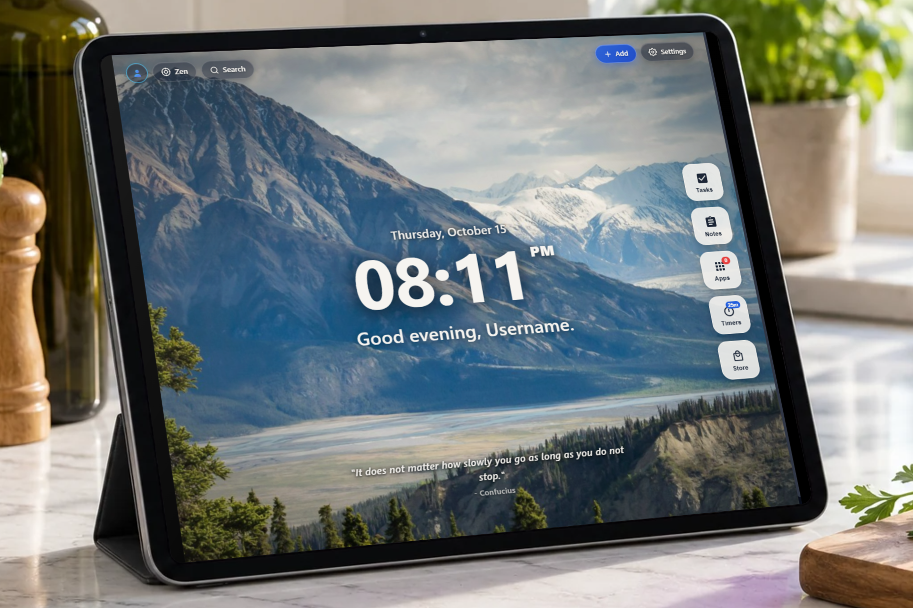
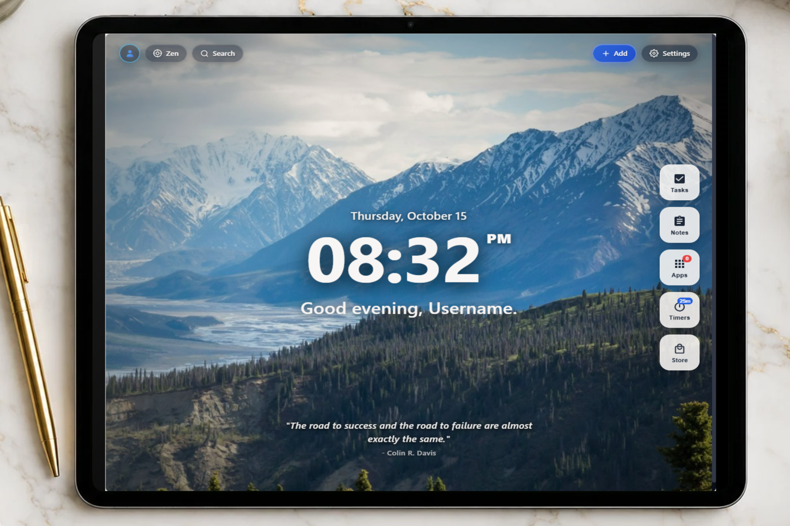
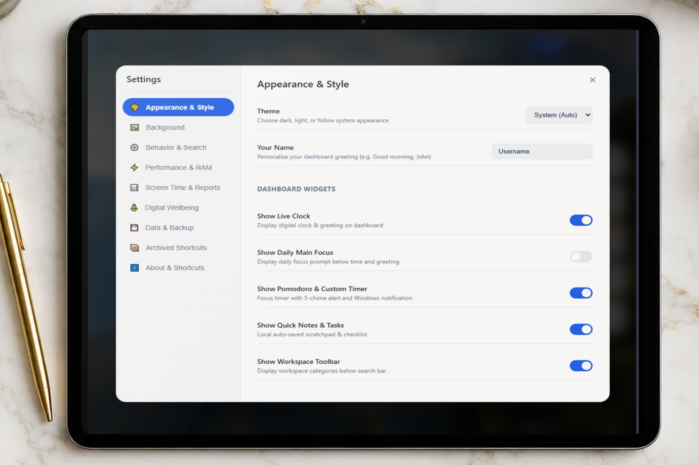
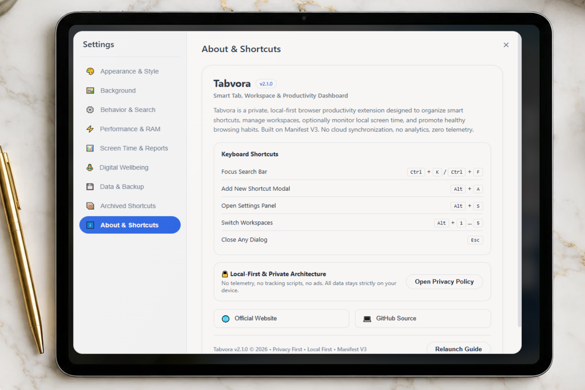

<div align="center">

# Tabvora

**Local-First Workspace & New Tab Productivity Dashboard for Chromium Browsers**

A clean, high-performance browser extension designed to organize web workflows, manage project workspaces, reduce system memory overhead, and maintain healthy browsing habits without cloud tracking.

[](https://chromewebstore.google.com/detail/ibejmhkigcbnfnobfkeebfnpodlpgjab)
[](https://developer.chrome.com/docs/extensions/mv3/intro/)
[](#privacy--local-first-architecture)
[](LICENSE)

<br/>



</div>

---

## Overview

Modern web browsers are powerful workstations, but default new-tab pages often introduce clutter, algorithmic distractions, and background telemetry. 

**Tabvora** replaces the default new tab with an extensible, local-first productivity dashboard. It combines workspace organization, an integrated Pomodoro focus timer, active memory optimization (RAM Saver), and optional digital wellbeing controls into a single, cohesive interface.

### Core Principles

- **Local-First Storage:** All bookmarks, notes, workspaces, and analytics are persisted exclusively inside your browser (`chrome.storage.local` and IndexedDB). No data is sent to external servers.
- **Strict Privacy:** Zero analytics, zero telemetry scripts, zero tracking pixels, and no account requirements.
- **Resource Efficiency:** Built on Manifest V3 standards with virtualized grid rendering and an event-driven background service worker that terminates when idle.
- **Opt-In Productivity:** Advanced features like form draft recovery and browsing duration limits are disabled by default, giving users full governance over their environment.

---

## Interface Showcase

| Main Workspace Dashboard | Appearance & Widget Settings | About & Keyboard Shortcuts |
| :---: | :---: | :---: |
|  |  |  |
| Clean clock, quote & widgets | Modular toggles & theme controls | Quick keys & local architecture |

---

## Key Features

### 1. Visual Shortcuts & Project Workspaces
- **Virtual Grid Rendering:** Handles hundreds of shortcuts smoothly with virtualized DOM node recycling, ensuring 60fps scrolling and negligible memory footprint.
- **Context Workspaces:** Separate your browsing contexts (e.g., Development, Research, Media, Client Work) and switch between them instantly.
- **Native Favicon Provider:** Resolves website icons locally using Chrome's internal favicon provider (`chrome://favicon2/`) without making external network calls.
- **Tagging & Color Labels:** Organize tiles with customizable category badges and color-coded indicators.
- **Bookmark Migration:** 1-click import tool to migrate existing browser bookmarks directly into structured Tabvora workspaces.

### 2. RAM Saver (Memory Optimizer)
- **Background Tab Sleeping:** Leverages native `chrome.tabs.discard` APIs to hibernate background tabs that consume excess memory.
- **Safety Guards:** Automatically protects pinned tabs, active audio/video playback, and forms with active user inputs from being discarded.
- **One-Click Execution:** Free up hundreds of megabytes of RAM during heavy multi-tab workflows.

### 3. Integrated Focus & Audio Synthesis
- **Configurable Pomodoro Timer:** 25-minute work sprints and 5-minute restorative intervals with a real-time countdown display.
- **Procedural Web Audio Engine:** Chime alerts and completion sounds are synthesized in real time using the W3C Web Audio API (`AudioContext`), eliminating external audio file dependencies.
- **Desktop Notifications:** Dispatches native system notifications when intervals complete, with an optional 5-minute snooze.

### 4. Digital Wellbeing & Browsing Allowances (Optional)
- **Session Break Alerts:** Periodic ergonomics reminders (Eye strain 20-20-20 rule, Stretch, Hydrate & Walk) calculated from active browser session dwell time.
- **Domain Time Limits:** Set custom daily allowances for distracting websites with non-intrusive in-tab glassmorphic countdown overlays.
- **Session-Only Persistence:** Wellbeing timers utilize `chrome.storage.session` and automatically reset at midnight or when the browser closes.

### 5. Quick Notes Scratchpad
- **Instant Capture:** Markdown-friendly notes widget directly on the new tab.
- **1-Click Paste:** Dedicated clipboard paste button using strictly scoped `clipboardRead` APIs.
- **Offline Export:** Save notes locally as `.txt` files with character count and timestamps.

### 6. Curated Visual Environments
- **40 HD Wallpapers:** High-resolution landscapes, architecture, minimalist workspaces, and abstract textures.
- **Dynamic Live Canvas Effects:** Real-time atmospheric particle animations (Aurora Borealis, Rain on Window, Fireflies, Cosmic Lake, Starlight).
- **Zen Minimalist Mode:** Clean hide/reveal toggle that clears the UI for zero-distraction focus.

---

## Supported Browsers

Tabvora is built strictly to W3C WebExtensions specifications and Manifest V3 standards. It operates natively across all major Chromium-based desktop browsers:

| Browser | Logo | Engine Requirement | Compatibility Status |
| :--- | :---: | :--- | :--- |
| **Google Chrome** |  | Chromium 102+ | Full native support (Primary target) |
| **Microsoft Edge** |  | Chromium 102+ | Full native support |
| **Brave Browser** |  | Chromium 102+ | Compatible with Brave Shields |
| **Opera & Opera GX** |  | Chromium 102+ | Full workspace & RAM Saver support |
| **Vivaldi** |  | Chromium 102+ | Compatible with tab stacks |
| **Arc Browser** |  | Chromium 102+ | Compatible with Arc Spaces |

---

## Technical Architecture

Tabvora is architected with modern modular standards for long-term maintainability and zero vendor lock-in.

```
tabvora/
├── manifest.json              # Manifest V3 configuration & permission boundaries
├── newtab.html                # Entry point DOM structure
├── css/
│   ├── base.css               # Reset, typography, layout grid & animations
│   ├── components.css         # UI widgets, modal dialogs, glassmorphic styles
│   └── tokens.css             # Color systems, light/dark variables, spacing tokens
├── js/
│   ├── app.js                 # Master controller, keyboard dispatcher, initialization
│   ├── background.js          # Service worker: alarms, tab lifecycle, RAM saver
│   ├── content-script.js      # Scoped in-tab overlays & sensitive field detection
│   ├── db.js                  # IndexedDB schema, migrations & CRUD operations
│   ├── dynamic-bg.js          # Canvas 2D procedural atmospheric animations
│   ├── virtual-grid.js        # Windowed virtualized DOM rendering engine
│   └── widgets.js             # Pomodoro, clock, notes, and wellbeing modules
├── backgrounds/               # Curated local wallpaper library
└── icons/                     # Vector-derived production icon assets
```

### Engineering Highlights

- **Event-Driven Service Worker:** Uses `chrome.alarms` and lifecycle listeners instead of persistent background processes, minimizing idle CPU usage to 0%.
- **Zero Remote Code:** Complies with strict Content Security Policy (`script-src 'self'`). No `eval()`, no `new Function()`, and no external CDN dependencies.
- **Sensitive Field Screening:** The optional Draft Recovery module utilizes heuristic screening to exclude sensitive inputs (`type="password"`, `autocomplete="cc-number"`, CVVs, PINs, tokens, SSNs, and phone numbers).

---

## Permissions Audit

Every permission declared in `manifest.json` corresponds directly to an active, user-facing feature:

| Permission | Purpose & Technical Scope |
| :--- | :--- |
| `storage` | Stores user shortcuts, workspaces, settings, and scratchpad notes locally on device. |
| `favicon` | Loads website icons via Chrome's internal provider without third-party network queries. |
| `tabs` | Required for RAM Saver tab sleeping (`chrome.tabs.discard`) and workspace tab switching. |
| `bookmarks` | Used exclusively when the user manually clicks "Import Bookmarks". |
| `contextMenus` | Adds a right-click context option allowing users to save links directly to Tabvora. |
| `alarms` | Manages event-driven local timers for Pomodoro intervals and midnight wellbeing resets. |
| `search` | Dispatches search bar queries to the user's chosen default search engine. |
| `clipboardRead` | Enables single-click pasting into the Quick Notes scratchpad upon user click. |
| `notifications` | Displays local desktop notifications for Pomodoro cycles and website limits. |
| `content_scripts` | Scoped strictly to top-level pages (`all_frames: false`) for optional form recovery and limit alerts. No broad host permissions requested. |

---

## Privacy & Local-First Architecture

Tabvora is designed around strict data sovereignty principles:

- **No Remote Telemetry:** No analytics scripts, Google Analytics, or third-party trackingSDKs.
- **No Cloud Synchronization:** Data stays isolated in local browser storage on your machine.
- **No User Profiling:** No accounts, passwords, or authentication requirements.
- **Data Exportability:** Complete JSON backup and restore capabilities for user data mobility.

For complete compliance details, see our published [Privacy Policy](https://shajibsikder.github.io/tabvora/privacy.html) and [Security Architecture](https://shajibsikder.github.io/tabvora/security.html).

---

## Keyboard Shortcuts

Tabvora includes native keyboard shortcuts for power-user navigation:

| Shortcut | Action |
| :--- | :--- |
| `Ctrl + K` / `Ctrl + F` | Focus the instant search bar |
| `Alt + A` | Open the Add Shortcut modal |
| `Alt + S` | Open the Settings & Appearance panel |
| `Alt + 1` ... `Alt + 5` | Switch between workspaces 1 through 5 |
| `Esc` | Dismiss any open modal dialog or active search |

---

## Installation

### Chrome Web Store (Recommended)
Install Tabvora directly from the official [Chrome Web Store](https://chromewebstore.google.com/detail/tabvora-%E2%80%93-smart-tab-sessi/ibejmhkigcbnfnobfkeebfnpodlpgjab).

### Developer / Local Installation
To inspect, test, or contribute to Tabvora locally:

1. Clone the repository:
   ```bash
   git clone https://github.com/shajibsikder/tabvora.git
   ```
2. Open your Chromium browser and navigate to the extensions page (`chrome://extensions` or `edge://extensions`).
3. Enable **Developer mode** via the toggle in the upper-right corner.
4. Click **Load unpacked** and select the `tabvora` folder within the cloned repository.
5. Open a new tab to launch your local build of Tabvora.

---

## Contributing

Contributions, bug reports, and feature suggestions are welcome. Please ensure pull requests maintain local-first data integrity, adhere to Manifest V3 CSP constraints, and include documentation updates where appropriate.

1. Fork the Project
2. Create your Feature Branch (`git checkout -b feature/Optimization`)
3. Commit your Changes (`git commit -m 'Add RAM Saver safety guard'`)
4. Push to the Branch (`git push origin feature/Optimization`)
5. Open a Pull Request

---

## License & Attribution

- **License:** Released under the [MIT License](LICENSE).
- **Asset Attribution:** Third-party libraries, audio synthesis algorithms, and image provenance are fully cataloged in [`tabvora/ATTRIBUTION.md`](tabvora/ATTRIBUTION.md) and [`tabvora/LICENSES.md`](tabvora/LICENSES.md).
